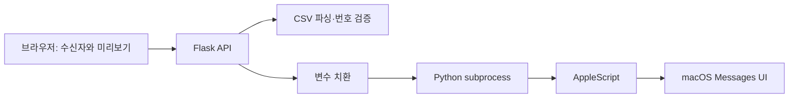

# MacMessageMerge

CSV의 이름·전화번호를 메시지에 반영하고 macOS Messages 앱으로 순차 발송하는 로컬 웹앱입니다. Flask 화면과 AppleScript UI 자동화를 연결합니다.

## 해결하려는 문제

여러 사람에게 이름이 들어간 안내를 보낼 때 수신자와 본문을 반복 입력해야 합니다. 이 앱은 CSV 파싱·전화번호 정규화·변수 치환을 처리하고, 수신자마다 Messages의 새 작성 화면을 여는 방식으로 반복 작업을 줄입니다.

공식 메시지 발송 API가 아닌 UI 자동화입니다. 실제 발송에는 사용자의 Mac, Messages 설정과 자동화 권한이 필요합니다.

## 주요 기능

- 수신자 직접 추가와 CSV 불러오기
- UTF-8/BOM·CP949·EUC-KR 해석, 헤더·구분자 인식, 전화번호 정규화와 CSV 중복 번호 제외
- `{name}`, `{phone}` 치환과 첫 수신자 기준 본문 미리보기
- 발송 전 확인 대화상자와 수신자별 처리 결과 표시
- AppleScript 문법·손쉬운 사용 권한·Messages 접근 진단
- 요청당 최대 300명, 업로드 최대 2MiB, 본문 템플릿 최대 2000자 제한

## 화면과 사용 흐름

공개 웹 데모는 없습니다. Messages가 설치된 Mac에서 실행한 뒤 `http://127.0.0.1:5001`에 접속합니다. GitHub Pages 같은 정적 호스팅에서 이 앱의 발송 기능을 실행할 수는 없습니다.

1. **수신자 추가**에서 직접 입력하거나 CSV를 불러옵니다.
2. **메시지 작성**에서 변수를 포함한 내용을 입력하고 미리보기를 확인합니다.
3. **연동 확인**으로 환경을 점검한 뒤, 실제 발송 확인 대화상자에서 진행 여부를 선택합니다.
4. **전송 결과**에서 수신자별 처리 성공·실패와 조기 중단 여부를 확인합니다.

화면은 [index.html](templates/index.html), 브라우저 상태와 API 요청은 [app.js](static/js/app.js)에 있습니다. 개인정보가 포함된 실제 발송 화면을 공개 예제로 사용하지 않습니다.

## 기술 스택

| 영역 | 사용 기술 |
|---|---|
| 로컬 서버 | Python 3.9 이상, Flask 3.1 계열, Waitress 3 계열 |
| 화면 | HTML, CSS, JavaScript, Fetch API |
| Messages 연동 | AppleScript, osascript, macOS Accessibility |
| CSV·검증 | Python 표준 csv·re·unittest |

실행 의존성 범위는 [requirements.txt](requirements.txt)에 있습니다.

## 구조와 주요 설계



**입력 처리와 발송을 나눴습니다.** [csv_parser.py](csv_parser.py)는 인코딩·헤더·전화번호를 처리하고 [message_utils.py](message_utils.py)는 변수를 치환합니다. [app.py](app.py)는 업로드와 발송 입력을 검사하고, [sender.py](sender.py)가 AppleScript 실행 결과를 공통 형식으로 반환합니다.

**클립보드 대신 입력 영역의 값을 설정합니다.** [send_message.applescript](scripts/send_message.applescript)는 수신자마다 `Command-N`으로 새 작성 화면을 열고 본문 영역의 `AXValue`에 Unicode 텍스트를 설정합니다. 값을 다시 읽어 본문이 일치하는지 확인한 뒤 Return을 입력합니다. 입력 영역·본문·포커스 관련 지정 오류는 해당 요청의 나머지 발송을 중단합니다. 모든 종류의 실패가 전체 중단으로 이어지는 것은 아닙니다.

**앱 서버의 외부 접근을 제한합니다.** Waitress는 `127.0.0.1`에 바인딩하고, 허용되지 않은 Origin의 변경 요청을 거부하며 CSP 등 응답 헤더를 설정합니다. CSV·수신자 목록·본문을 앱 DB나 파일에 보관하는 기능은 없습니다. 외부 HTTP API나 CDN도 호출하지 않습니다. 다만 Messages의 대화 기록과 macOS 동작, 앱 진단 로그까지 저장되지 않는다는 뜻은 아닙니다.

## 설치와 실행

준비물은 macOS, Python 3.9 이상, 사용 설정을 마친 Messages입니다. 특정 macOS 버전에서의 발송 성공을 보증하는 호환성 테스트 자료는 포함되어 있지 않습니다.

```bash
git clone https://github.com/lee-junyeol/MacMessageMerge.git
cd MacMessageMerge
chmod +x run.sh
./run.sh
```

[run.sh](run.sh)는 `.venv`를 만들고 의존성을 설치한 뒤 브라우저를 엽니다. 기본 주소는 `http://127.0.0.1:5001`이고 종료는 터미널에서 `Ctrl+C`입니다. 포트는 `PORT` 환경변수로 변경할 수 있습니다.

### macOS 권한과 Messages 설정

1. 시스템 설정의 **개인정보 보호 및 보안 → 손쉬운 사용**에서 실행 터미널의 UI 자동화를 허용합니다.
2. 자동화 권한 요청이 나타나면 Messages/System Events 제어를 허용합니다.
3. 앱의 **연동 확인** 결과를 확인합니다. 권한 변경 후 실행 프로그램을 다시 시작해야 할 수 있습니다.

발신 ID와 실제 전송 경로는 Messages 및 사용자의 Apple·통신사 설정에 따릅니다. 앱이 발신 번호를 강제로 지정하지 않습니다. 문자 전달 설정은 [Apple Messages 안내](https://support.apple.com/guide/messages/set-up-messages-on-mac-ichte16154fb/mac)를 참고하세요. 수신 동의를 받은 대상에게만 사용하고, 본인 번호 한 건으로 환경을 확인한 뒤 사용해야 합니다.

### CSV와 변수

```csv
이름,전화번호
예시이름,010-0000-0000
```

```text
{name}님, 안녕하세요.
등록된 연락처는 {phone}입니다.
```

이름 헤더는 `이름`, `성명`, `name`, 전화번호는 `전화번호`, `휴대폰`, `연락처`, `phone`, `mobile`, `tel` 등을 인식합니다. 헤더를 찾지 못하면 첫 열을 이름, 두 번째 열을 번호로 사용합니다. 유효하지 않거나 중복된 CSV 행은 제외하며 제외 건수를 반환합니다. 예시 번호는 발송 테스트용 수신자가 아닙니다.

## 테스트와 검증

CSV·번호 검증·변수 치환 테스트는 Messages를 조작하지 않습니다.

```bash
python3 -B -m unittest discover -s tests -v
```

AppleScript 문법 검사도 발송 없이 실행할 수 있습니다.

```bash
osacompile -o /tmp/MacMessageMerge.scpt scripts/send_message.applescript
```

2026-11-13 문서 점검에서 [기존 단위 테스트](tests/test_core.py) 5개와 AppleScript 컴파일이 통과했습니다. 컴파일 중 실행 환경의 입력 서비스 경고가 있었으며, 실제 Messages 제어·발송·OS별 호환성은 검증하지 않았습니다. 자동 CI workflow는 없습니다.

## 현재 상태와 알려진 한계

- UI 자동화이므로 macOS/Messages 업데이트, 창 상태와 포커스에 따라 실패할 수 있습니다. 발송 중 다른 창이나 Messages를 조작하지 마세요.
- 처리 성공은 AppleScript가 Return 입력 후 정상 반환했다는 의미입니다. 실제 배달·수신 확인 기능은 없습니다.
- 하나의 요청 안에서는 순차 처리하지만 여러 탭·클라이언트의 동시 발송을 직렬화하는 전역 잠금은 없습니다. 동시에 여러 발송을 실행하지 마세요.
- 같은 상대의 메시지는 Messages에서 기존 대화 스레드와 합쳐 보일 수 있습니다. 매번 새 작성 동작을 수행하는 것과 새 대화 기록을 보장하는 것은 다릅니다.
- 진단 로그는 `~/Library/Logs/MacMessageMerge/app.log`에 기록됩니다. 일반 발송 로그는 번호를 마스킹하고 본문 대신 길이를 기록합니다. 오류 보고 전에는 로그의 개인정보를 직접 확인·제거하세요.
- macOS 권한, 실제 메시지 경로·비용과 전달 상태는 앱의 단위 테스트 범위 밖입니다.

## 관련 링크와 라이선스

- [변경 이력](CHANGELOG.md), [보안 안내](SECURITY.md)
- [Apple 메시지 보내기 안내](https://support.apple.com/guide/messages/send-messages-icht35827/mac)
- [Apple 키보드 단축키](https://support.apple.com/guide/messages/keyboard-shortcuts-ichtc78b3bff/mac)
- [Apple 손쉬운 사용 권한 안내](https://support.apple.com/guide/mac-help/allow-accessibility-apps-to-access-your-mac-mh43185/mac)

MIT License. Copyright (c) 2026 Lee Junyeol. 자세한 조건은 [LICENSE](LICENSE)를 확인하세요.
